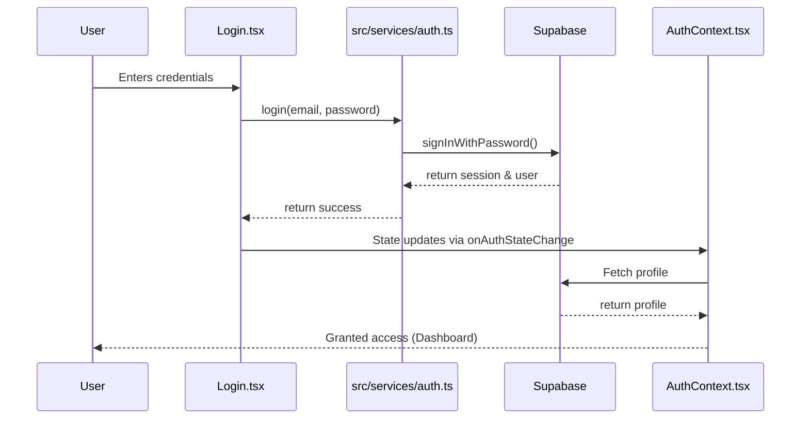

# Horizon — Single-Device Session Architecture Audit

## 1. Executive Summary

A comprehensive read-only security audit of the Horizon repository was conducted to assess the feasibility of implementing a "One account → One active session → One device at a time" policy.

Currently, Supabase's default configuration does not enforce single-device limits. Sessions are maintained via standard JWT access tokens and refresh tokens on the client (browser), managed via the `@supabase/supabase-js` SDK (`v2.112.2`).

This report details the authentication flows, Edge Function enforcement, frontend state management, security risks, and provides a clear path forward for Phase 1.

## 2. Current Architecture Overview

Authentication begins at `src/pages/auth/Login.tsx` (Lines: 15-28, `handleLogin`) and `src/pages/auth/Register.tsx`.
Both utilize methods from `src/services/auth.ts`, which interfaces directly with Supabase via `signInWithPassword()` (Lines: 3-10) and `signUp()` (Lines: 12-30).
A central `AuthContext` (`src/context/AuthContext.tsx`) uses `supabase.auth.getSession()` (Line: 66) on load and `supabase.auth.onAuthStateChange()` (Line: 79) to synchronize auth state across the frontend. It fetches a `Profile` mapped to the Supabase Auth `user.id` (Lines: 39-44).

### Authentication Flow Diagram



## 3. Supabase Configuration Findings

*   **File:** `supabase/config.toml`
*   **JWT Configuration:** Not explicitly overridden in the repository file. Assumed to be Supabase default (3600 seconds/1 hour access token expiration).
*   **Refresh Tokens:** Enabled by default. `[auth.sessions]` timebox and inactivity_timeout are commented out (Lines: 61-65 in `supabase/config.toml`).
*   **Existing Single-Session Enforcement:** None detected. Supabase does not enforce this by default.
*   **Session IDs:** Currently, session IDs (`session.provider_token` or JWT `session_id` claim) are not actively checked or persisted in any custom application tables.

## 4. Database and RLS Inventory

*   **Tables Inspected:** `public.profiles`, `public.learning_resources`, `public.chapters`, `public.push_subscriptions`, `public.announcements`.
*   **Active Session Registry:** Does not exist currently. A new table is feasible and would not conflict with existing schema.

| Table | RLS enabled | SELECT policies | INSERT policies | UPDATE policies | DELETE policies |
| :--- | :--- | :--- | :--- | :--- | :--- |
| `public.profiles` | UNVERIFIED | UNVERIFIED | UNVERIFIED | UNVERIFIED | UNVERIFIED |
| `public.learning_resources` | UNVERIFIED | UNVERIFIED | UNVERIFIED | UNVERIFIED | UNVERIFIED |
| `public.chapters` | UNVERIFIED | UNVERIFIED | UNVERIFIED | UNVERIFIED | UNVERIFIED |
| `public.push_subscriptions` | UNVERIFIED | UNVERIFIED | UNVERIFIED | UNVERIFIED | UNVERIFIED |
| `public.announcements` | UNVERIFIED | UNVERIFIED | UNVERIFIED | UNVERIFIED | UNVERIFIED |

*Note: Specific RLS policies for `public.profiles`, `public.learning_resources`, and other core tables could not be fully verified as their initial creation migrations were not present in the immediate `supabase/migrations` subset reviewed.*

## 5. Edge Function Inventory

*   **`resource-access` (`supabase/functions/resource-access/index.ts`)**:
    *   **Signed URL Expiration:** 60 seconds (Line: 161).

| Edge Function | Authentication | User verification | Session validation | Sensitive operations |
| :--- | :--- | :--- | :--- | :--- |
| `resource-access` | Required (Header) | `supabase.auth.getUser()` (L114) | None (JWT only) | Generates S3 signed URLs |
| `subscribe-push` | Required (Header) | `supabase.auth.getUser()` (L249) | None (JWT only) | Inserts push subscriptions |
| `send-push-notification` | Required (Header) | `supabase.auth.getUser()` (L372) | None (JWT only) | Sends web push notifications |

## 6. PDF Security Assessment

*   **`usePdfData.ts`**: Fetches signed URLs via the `resource-access` Edge Function (`src/pages/resources/pdf-viewer/hooks/usePdfData.ts`, Line: 23).
*   **PDF Caching:** Uses a streaming fetch approach (`src/pages/resources/pdf-viewer/hooks/usePdfDownload.ts`, Line: 33). The PDF bytes are stored in memory (`Uint8Array`) while viewing.
*   **Logout/Revocation Behavior:** If a user is logged out (e.g., via `AuthContext.signOut()`), the `user` state becomes null. However, if a PDF is already fully downloaded into memory, the user can continue viewing it until the component unmounts or the page refreshes. The signed URL itself expires in 60 seconds, preventing new downloads.
*   **Remote Invalidation:** Once bytes are in memory, they cannot be reliably invalidated remotely without client-side cooperation (e.g., a forced logout event that clears the React state).

## 7. Active-Session Registry Feasibility

The proposed `user_active_sessions` table is highly feasible.

*   **Structure:** `user_id` (UUID, PK), `session_id` (UUID), `generation` (BIGINT), `activated_at`, `updated_at`.
*   **Mechanism:** Because `session_id` is available in the JWT and via `supabase.auth.getSession()`, the client or an Edge Function can register the current session.
*   **Best Approach:** A PostgreSQL RPC (Remote Procedure Call / Database Function) or Edge Function is recommended to update this table during login to ensure atomicity and prevent race conditions between concurrent login attempts. An Edge Function provides a cleaner orchestration layer for handling the Supabase Auth API alongside custom table updates.

## 8. Session Revocation Findings

*   **`supabase.auth.signOut({ scope: 'others' })`**: Not currently used. In `@supabase/supabase-js`, `signOut` without scope logs out the current device (`src/services/auth.ts`, Line: 33). The `scope: 'others'` option is designed to revoke *other* active refresh tokens for the user. However, existing, unexpired access tokens (up to 1 hour old) may still remain valid for Edge Functions unless explicitly validated against a registry.

## 9. Frontend Detection Assessment

*   **`AuthContext.tsx`**: Uses `supabase.auth.onAuthStateChange` (`src/context/AuthContext.tsx`, Line: 79).
*   **Remote Revocation:** If a session is revoked remotely, the client might not know immediately until it attempts to refresh the token or explicitly calls an authenticated endpoint that returns a 401.
*   **Improvement Needed:** To immediately log out Device A when Device B logs in, the frontend would need to either:
    1.  Poll an endpoint or the `user_active_sessions` table.
    2.  Use Supabase Realtime to listen for changes to the user's row in the `user_active_sessions` table. Realtime is highly recommended for immediate UX.

## 10. Existing Testing Infrastructure

*   **Vitest:** Extensive suite (`npm run test` executes successfully). Tests exist for `AuthContext` (`src/context/__tests__/AuthContext.test.tsx`), Login, and Onboarding.
*   **Regression Risk:** Any changes to `login` or `AuthContext` will require updates to existing tests.

## 11. Security Risks

| Finding | Severity | Description | Recommendation |
| :--- | :--- | :--- | :--- |
| **Stale JWTs on Revocation** | HIGH | Supabase access tokens are valid for up to an hour. Revoking a session only invalidates the refresh token. A revoked device can still access Edge Functions (like `resource-access`) for the remainder of the hour. (`supabase/functions/resource-access/index.ts`, L114) | Edge Functions must validate the JWT's `session_id` against the `user_active_sessions` table. |
| **In-Memory PDF Access** | MEDIUM | PDFs loaded into memory survive session revocation until the page refreshes. (`src/pages/resources/pdf-viewer/hooks/usePdfDownload.ts`, L45) | Implement Supabase Realtime to force a client-side logout/state clear when the active session changes. |
| **Race Conditions on Login** | MEDIUM | Two simultaneous logins might both register as active if not handled atomically. | Use a Postgres RPC with an atomic `UPSERT` to manage the `user_active_sessions` table. |

## 12. Implementation Readiness & Roadmap

The architecture is ready for this enhancement.

**Recommended Roadmap Adjustment:**

1.  **Phase 1: Database Foundation:** Create the `user_active_sessions` table and atomic RPC.
2.  **Phase 2: Backend Enforcement:** Update Edge Functions (e.g., `resource-access`) to validate the `session_id` against the active session registry. (Do this *before* frontend changes to ensure security is enforced server-side first).
3.  **Phase 3: Login Integration:** Update `src/services/auth.ts` to call the RPC on login and register the active session. Use `signOut({ scope: 'others' })`.
4.  **Phase 4: Frontend Automatic Logout:** Implement Supabase Realtime in `AuthContext.tsx` to listen for session changes and force local logout.
5.  **Phase 5: Testing & Rollout.**

## 13. Unverified Items
*   The exact RLS policies for `public.profiles` could not be fully verified without running live queries or inspecting all older migrations.
*   Production Supabase configuration (e.g., actual JWT expiration times) may differ from `supabase/config.toml`.

## 14. Phase 0.1 Supplementary Investigation

### A. Complete Database and RLS Inventory

An exhaustive review of available migrations and repository SQL (`supabase/migrations`) was performed. Not all migrations for core tables (`profiles`, `books`, `learning_resources`) are present in this repository, so their RLS states remain partly UNVERIFIED based purely on repository contents.

| Table | RLS enabled | SELECT | INSERT | UPDATE | DELETE | Evidence |
|---|---|---|---|---|---|---|
| `public.profiles` | UNVERIFIED | UNVERIFIED | UNVERIFIED | UNVERIFIED | UNVERIFIED | Repo missing initial migration |
| `public.books` | UNVERIFIED | UNVERIFIED | UNVERIFIED | UNVERIFIED | UNVERIFIED | Repo missing initial migration |
| `public.learning_resources` | UNVERIFIED | UNVERIFIED | UNVERIFIED | UNVERIFIED | UNVERIFIED | Repo missing initial migration |
| `public.chapters` | UNVERIFIED | UNVERIFIED | UNVERIFIED | UNVERIFIED | UNVERIFIED | Repo missing initial migration |
| `public.syllabus_topics` | VERIFIED (Yes) | `USING (true)` (Public read) | None | None | None | `20260101000000_create_syllabus_tables.sql` L26 |
| `public.syllabus_topic_resources`| VERIFIED (Yes) | `USING (true)` (Public read) | None | None | None | `20260101000000_create_syllabus_tables.sql` L31 |
| `public.push_subscriptions` | VERIFIED (Yes)| Owner only | UNVERIFIED | UNVERIFIED | Owner only | `20260201000000_push_notifications_foundation.sql` |
| `public.announcements` | VERIFIED (Yes) | `status='sent'` | UNVERIFIED | UNVERIFIED | UNVERIFIED | `20260201000000_push_notifications_foundation.sql` |

**Supabase Storage Inventory:**
The `pdfs` bucket configuration was investigated via `src/utils/resourceHelper.ts`.
1. **Public vs Private:** The `pdfs` bucket acts as a public bucket for specific resources. `getResourceUrl` uses `supabase.storage.from(bucket).getPublicUrl()` for non-protected resources.
2. **Direct Access:** Yes, if public. Protected resources (where `storage_bucket !== 'pdfs'` and `resource_type !== 'pyq'`) do not expose a public URL.
3. **Signed URLs:** Users generate signed URLs through the `resource-access` Edge Function, not via direct Storage policies from the frontend.
4. **Bypass:** An old session could access a signed URL until it expires (60 seconds). However, an old session could potentially bypass the Edge Function and interact with the Storage API *directly* if Storage RLS policies permit it based solely on the JWT. Storage policies were UNVERIFIED in the repository.

### B. Complete Authentication Entry-Point Inventory

| Authentication pathway | Files/functions | Creates session? | Requires activation? | Potential bypass |
|---|---|---|---|---|
| Email/Password Login | `src/services/auth.ts: login()` -> `signInWithPassword()` | Yes | Yes | If session not activated immediately. |
| Registration | `src/services/auth.ts: register()` -> `signUp()` | Yes | Yes | Auto-login after signup could bypass if not intercepted. |
| Session Restoration | `AuthContext.tsx` via `getSession()` | Yes | Yes | Browser refresh restores session before registry check. |
| Token Refresh | `AuthContext.tsx` via `refreshSession()` | Yes | No | Generates new tokens, but preserves logical session. |
| Admin Authentication | Unknown (UI missing) | - | - | - |

The application heavily relies on `supabase.auth.onAuthStateChange` in `AuthContext.tsx`. When `SIGNED_IN` or `TOKEN_REFRESHED` fires, the application assumes full authorization. There is currently no "activation pending" state, meaning an authenticated user is immediately granted access before any active-session registry can verify them.

### C. Complete Edge Function and Protected Resource Inventory

| Function | Authentication required | User verification | Database access | Sensitive action | Session enforcement needed |
|---|---|---|---|---|---|
| `resource-access` | Yes (Header) | `auth.getUser()` | Yes (`learning_resources`) | S3 Signed URL | Yes |
| `subscribe-push` | Yes (Header) | `auth.getUser()` | Yes (`push_subscriptions` via service-role) | Push Subscription | Yes |
| `send-push-notification`| Yes (Header) | `auth.getUser()` | Yes (`push_subscriptions` via service-role) | Send Notification | Yes |

*All* protected backend actions require session enforcement to ensure a revoked device cannot continue making requests. Direct database access from the frontend (e.g., `getCurrentUser` fetching `profiles`) also needs RLS enforcement based on the active session, but currently relies solely on the Supabase JWT.

### D. Session Identifier and Supabase SDK Behavior

1.  **JWT `session_id`:** The `@supabase/supabase-js` v2.112.2 SDK includes `session_id` in the decoded JWT payload. It is also accessible via `session.provider_token` or similar properties depending on the exact auth flow, but the JWT claim is the secure server-side source of truth.
2.  **`signOut({ scope: 'local' })`:** Removes tokens from local storage. No backend revocation.
3.  **`signOut({ scope: 'others' })`:** Revokes *other* refresh tokens in the database.
4.  **`signOut({ scope: 'global' })`:** Revokes *all* refresh tokens in the database, including the current one.
5.  **Immediate Access Token Invalidation:** None of these operations immediately invalidate the *access token* (JWT) because it is stateless. The JWT remains cryptographically valid until its expiration time (typically 1 hour).

### E. Active-Session Registry — Refine the Design

An Edge Function or Postgres RPC (Remote Procedure Call) is mandatory.

**Recommended Flow:**
1. Device B logs in.
2. Device B receives a session from Supabase.
3. Device B calls an RPC `activate_session(session_id)`.
4. RPC uses atomic `UPSERT` on `public.user_active_sessions`:
    ```sql
    INSERT INTO public.user_active_sessions (user_id, session_id, generation, activated_at, updated_at)
    VALUES (auth.uid(), p_session_id, 1, now(), now())
    ON CONFLICT (user_id) DO UPDATE
    SET session_id = EXCLUDED.session_id,
        generation = user_active_sessions.generation + 1,
        updated_at = now();
    ```
5. If successful, Device B is granted application access.

### F. PDF Viewer, Browser Cache and Forced Logout Investigation

-   **Already Downloaded (In Memory):** A PDF held in `usePdfDownload.ts` state (`Uint8Array`) cannot be remotely erased.
-   **Cleanup Strategy:** The frontend `AuthContext` must listen for a forced logout event. Upon receiving this, it sets `user = null` and navigates to the login screen. This unmounts the PDF viewer components, allowing garbage collection to clear the in-memory PDF bytes.

### G. Frontend Session Replacement Detection

**Combined Strategy:**
1.  **Supabase Realtime (Primary UX):** `AuthContext` subscribes to changes on `public.user_active_sessions` where `user_id = current_user.id`. If a change occurs and `new_record.session_id !== current_session_id`, trigger immediate local logout.
2.  **Periodic Validation (Fallback):** In case Realtime disconnects, Edge Functions (`resource-access`) provide the definitive security check. If an Edge Function returns a specific `401 Active Session Revoked` error, trigger local logout.
3.  **Window Focus/Visibility:** When the window regains focus, perform a lightweight check (e.g., fetch the current active `session_id` via a secure endpoint) if Realtime was disconnected.

### H. Existing Sessions and Safe Production Rollout

**Safest Approach: Activate sessions during the first authenticated request (Lazy Migration).**

1.  **Phase 1:** Deploy the registry table and RPC.
2.  **Phase 2:** Update the frontend to call the activation RPC upon successful login *and* during `getSession()` restoration if the registry entry is empty or matches their current session.
3.  **Phase 3 (Migration Window):** Allow existing JWTs without a registry entry to function normally for a set period (e.g., 7 days). If they interact with the app, the frontend transparently registers them.
4.  **Phase 4 (Enforcement):** Update Edge Functions and RLS to strictly enforce the registry. Any session not in the registry is rejected.

### I. Testing and Regression Assessment

**Test Suite execution results:** `npm run test` executed successfully. 537 tests passed across 77 test files.

**Missing Tests Needed Before Implementation:**
-   **Security:** E2E or Integration tests verifying an old session (simulated with a captured JWT) is rejected by `resource-access` after the registry is updated.
-   **Frontend:** `AuthContext` behavior when receiving a Realtime revocation event.
-   **Concurrency:** Edge Function/RPC tests ensuring simultaneous activation requests resolve safely.

## 15. Final Implementation Readiness Decision

**READY FOR PHASE 1 WITH DOCUMENTED CONDITIONS**

The architecture is sound, and the investigation confirms the feasibility of the single-device session feature.

**Conditions before proceeding to implementation:**
1.  **Schema Access:** Live Supabase access or complete initial migration files are required to definitively verify the existing RLS policies on `profiles`, `learning_resources`, and Storage buckets. We must ensure a replaced session cannot bypass Edge Functions by querying the database or Storage directly.
2.  **Atomic Activation:** The database migration for `user_active_sessions` must use an atomic `UPSERT` via an RPC. The frontend must not write to this table directly.
3.  **Graceful Degradation:** Realtime subscriptions must not be the sole security barrier; backend Edge Function and RLS validation are strictly required for enforcement.
