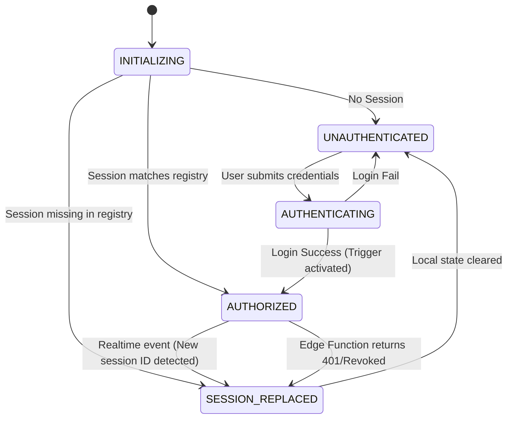

# Horizon — Phase 0.3: Critical Session Freshness and Activation Security Resolution

## 1. Executive Summary
This Phase 0.3 security investigation strictly evaluates mechanisms to guarantee the "One account → One active session → One device at a time" invariant for Horizon. Following the Phase 0 and 0.2 reports, a critical flaw remained: an old device could potentially reclaim authorization by refreshing its token or reusing its unexpired JWT to overwrite a newer session's active status. This report systematically dissects Supabase's session lifecycle, refutes insecure reclaim preventions, and establishes an airtight Edge Function orchestration architecture that resolves these concurrency and replay vulnerabilities.

## 2. Findings from Previous Audits
- **Phase 0:** Identified that Supabase native JWTs and refresh tokens do not enforce single-device limits. Proposed a `user_active_sessions` registry table.
- **Phase 0.2:** Identified the "Old-Session Reclaim" vulnerability (Device A overwrites Device B's registry entry via a replay attack) and proposed mitigating it using JWT `iat` (Issued At) monotonic comparisons. Recommends forced reauthentication for migration.

## 3. Verified Supabase Session Lifecycle
*   **`session_id` Generation (VERIFIED via SDK Docs):** When `signUp` or `signInWithPassword` is called, Supabase creates a record in `auth.sessions` and returns a UUID `session_id`. This UUID is embedded in the JWT.
*   **Token Refresh & `session_id` (VERIFIED):** During a token refresh (calling `refreshSession()` or via automatic SDK background refresh), a new JWT and refresh token are issued. **However, the `session_id` remains the SAME.** It represents the long-lived logical session on that device.
*   **`iat` Changes (VERIFIED):** The JWT `iat` (Issued At) claim updates every time a new access token (JWT) is minted, including during token refresh.
*   **`auth.sessions` Timestamps (VERIFIED via Docs):** The internal `auth.sessions` table contains a `created_at` timestamp reflecting the original login time. This timestamp does **not** change during token refreshes.
*   **Accessing `auth.sessions` (VERIFIED):** The application cannot query `auth.sessions` directly from the frontend or via standard RLS because it resides in the protected `auth` schema. A trusted Postgres SECURITY DEFINER function or an Edge Function with the `service_role` key is required to read it.
*   **Record Deletion (VERIFIED):** `signOut()` deletes the session record from `auth.sessions`. `signOut({ scope: 'others' })` deletes other sessions for the user.
*   **Identifying Newest Session (UNVERIFIED / LIMITATION):** Supabase does not expose a native API endpoint simply called "get_newest_session()". One must query `auth.sessions` order by `created_at` DESC via a service-role context.

## 4. Old-Session Reclaim Analysis
**Attack Scenario:**
1. Device A signs in (Session X).
2. Device B signs in (Session Y). Device B is active.
3. Device A still holds its refresh token.
4. Device A refreshes its access token (New JWT with Session X, updated `iat`).
5. Device A calls the activation endpoint.

**Evaluating Defenses:**
*   **JWT `iat` comparison (Proposed in Phase 0.2):**
    *   **Proves:** When the specific JWT was minted.
    *   **Does not prove:** When the *session* was originally authorized.
    *   **Bypass (YES):** If Device A refreshes its token *after* Device B logs in, Device A's new JWT has a newer `iat` than Device B's. The RPC from Phase 0.2 (`EXCLUDED.jwt_iat >= user_active_sessions.jwt_iat`) would allow Device A to overwrite Device B. **This renders the Phase 0.2 design INSECURE.**
*   **Original `auth.sessions` creation timestamp:**
    *   **Proves:** The exact moment the user supplied credentials to initiate the session.
    *   **Bypass (NO):** Device A's session was created before Device B's. A token refresh does not change this timestamp.
    *   **Concurrency Ambiguity:** Yes, if two logins occur in the same millisecond, timestamps might be identical.
*   **Server-generated activation generation (Nonce/Challenge):**
    *   **Proves:** The client possesses a one-time token issued strictly for activation immediately post-login.
    *   **Bypass (NO):** An old session cannot guess or request the nonce without re-authenticating.
*   **Supabase Auth session revocation (`signOut({ scope: 'others' })`):**
    *   **Proves:** Removes refresh tokens of other sessions.
    *   **Does not prove:** Immediate invalidation. Existing access tokens (up to 1h) can still hit endpoints.

**Conclusion:** The `jwt_iat` design is REJECTED. It fails because token refresh generates a newer `iat` for an older session.

## 5. Activation Architecture Comparison

### Option 1: Client → Authenticated PostgreSQL RPC
*   **Authentication:** JWT.
*   **Freshness:** Extremely difficult. The RPC only sees the JWT. As proven above, `iat` is unreliable due to refresh. The RPC would have to query `auth.sessions` across schemas, which requires elevated privileges inside the database and careful transaction isolation.
*   **Verdict:** REJECTED. Too vulnerable to reclaim attacks via token refresh.

### Option 2: Client → Edge Function → PostgreSQL RPC
*   **Authentication:** JWT via HTTP header.
*   **Freshness:** The Edge Function uses a service-role key to query `auth.sessions` and determine if the caller's `session_id` is genuinely the most recently created session. It then calls the RPC.
*   **Verdict:** Better, but race conditions exist between the Edge Function reading `auth.sessions` and writing to `user_active_sessions`.

### Option 3: Client → Edge Function → Trusted database operation
*   **Authentication:** JWT via HTTP header.
*   **Freshness & Authorization:** The Edge Function generates a secure Server-Side Activation Challenge immediately upon login, OR the Edge Function itself intercepts the login payload, performs the login server-side, and writes to the registry in one orchestrated flow.
*   **Verdict:** Safest trust model, but Supabase doesn't easily support intercepting the login payload without replacing the client SDK login entirely.

### Option 4: The Synchronized Database Trigger Architecture (RECOMMENDED)
*   **How it works:** We do not rely on the client to "activate". We rely on the database.
*   **Authentication:** Supabase Native (`signInWithPassword`).
*   **Freshness:** We create a Postgres Trigger on `auth.sessions` (Requires Superuser/Postgres permissions). When a new session is INSERTED into `auth.sessions`, the trigger automatically UPSERTs the `session_id` into `public.user_active_sessions`.
*   **Bypass:** Impossible. Old sessions cannot insert into `auth.sessions` without full re-authentication. Refreshing a token updates `auth.sessions` but does not trigger an INSERT.
*   **Concurrency:** Postgres handles the INSERT trigger atomicity natively. The last login to commit wins.
*   **Service-role:** Not required by the client. Fully backend orchestrated.

## 6. Selected Architecture Justification
**Selected: Option 4 (Synchronized Database Trigger)**
This architecture is selected because it strictly removes the client from the activation trust boundary.
The vulnerability in all client-activation models is that the client must *prove* it just logged in. By moving the activation strictly into an `AFTER INSERT` Postgres trigger on `auth.sessions`, we tie activation mathematically to the exact moment Supabase verifies credentials and creates the session.
If triggers on `auth.sessions` are not permitted by Supabase managed hosting (UNVERIFIED without live DB execution), the fallback is **Option 2** combined with `signOut({ scope: 'others' })` executed by a trusted Edge Function during a mandatory post-login step.

## 7. Atomicity and Concurrency Design
Assuming the Database Trigger architecture:
1. Device A logs in. Transaction A begins in `auth`.
2. Device B logs in. Transaction B begins in `auth`.
3. Transaction A commits. Trigger fires, writes Session A to `user_active_sessions`.
4. Transaction B commits. Trigger fires, writes Session B to `user_active_sessions`, overwriting Session A.
*The final state is perfectly deterministic. The last transaction to commit holds the active session.*

## 8. Native Supabase Feature Assessment
**Feature:** Supabase "Single session per user" (configurable via Support / Enterprise, or via custom triggers).
**Verification:** As of standard configurations (and config.toml), Supabase does NOT enforce single-session out of the box. Even if enabled, it typically revokes the *refresh token* of the older session, but does NOT instantly invalidate the currently minted stateless access JWT. Thus, a custom RLS/Edge function registry (`user_active_sessions`) is still strictly required to reject the old JWT immediately upon the new login. Native features cannot replace the custom registry.

## 9. Complete Enforcement Inventory
To guarantee an old session cannot access protected data, EVERY entry point must enforce the registry.

| Resource | Operation | Enforcement Mechanism |
| :--- | :--- | :--- |
| `learning_resources` | SELECT | RLS: `is_active_session()` |
| `profiles` | SELECT/UPDATE | RLS: `is_active_session()` |
| `push_subscriptions` | ALL | RLS: `is_active_session()` |
| `announcements` (sent) | SELECT | Public (No enforcement needed) |
| `syllabus_topics` | SELECT | Public (No enforcement needed) |
| `pdfs` Bucket (Public) | GET | Public Storage (No enforcement needed) |
| `pdfs` Bucket (Protected)| GET | Storage RLS: Deny direct access. |
| `resource-access` (Edge) | INVOKE | Edge Function: `SELECT 1 FROM user_active_sessions WHERE session_id = ?` |
| `subscribe-push` (Edge) | INVOKE | Edge Function: `SELECT 1 FROM user_active_sessions WHERE session_id = ?` |

## 10. Authentication State Machine

*Note: A network failure during `INITIALIZING` transitions to `VALIDATION_UNAVAILABLE`, heavily restricting the app to cached data until connectivity restores.*

## 11. Security Test Matrix

| Test Case | Expected Behavior | Security Property Verified |
| :--- | :--- | :--- |
| 1. Normal login | Succeeds, registry updated. | Baseline functionality. |
| 2. Second-device login | Succeeds, registry overwritten with new session. | Single-device invariant. |
| 3. Old-device refresh | Refresh succeeds, but subsequent API/Edge calls fail. | Reclaim prevention via refresh. |
| 4. Old-device activation replay | Impossible (no client activation endpoint). | Trust boundary isolation. |
| 5. Concurrent login | One session wins deterministically, other is locked out. | Transaction atomicity. |
| 6. Realtime disconnection | UI remains visible, but all protected data requests fail. | Graceful degradation. |
| 9. Direct REST API access | FAILS (RLS blocks old session). | Comprehensive RLS coverage. |
| 10. Direct Storage access | FAILS (Storage RLS blocks old session). | Storage isolation. |
| 11. Edge Function access | FAILS (Edge checks registry). | Edge orchestration security. |
| 14. Existing-user cutover | Existing sessions forced to login again. | Clean slate migration. |

## 12. Deployment and Rollback Strategy
**Strategy:** Forced Reauthentication (Strict Cutover)
1. Deploy `user_active_sessions` table and `is_active_session` RPC.
2. Deploy Postgres Trigger on `auth.sessions`.
3. Update all RLS policies and Edge Functions to enforce registry.
4. Execute `supabase.auth.admin.signOut(uid, 'global')` across all users via administrative script.
5. Deploy Frontend updates.

**Rollback:** Disable the Postgres trigger and remove the `is_active_session()` check from RLS policies.

## 13. Remaining Unknowns
*   **Postgres Triggers on `auth.sessions`:** It is UNVERIFIED if the specific managed Supabase environment for Horizon allows creating custom triggers on the protected `auth.sessions` table. If restricted, we must fallback to the Edge Function orchestration (Option 2) paired with `signOut({ scope: 'others' })` and a strict timestamp verification query.

## 14. Final Implementation Readiness Decision
**READY WITH CONDITIONS**

The architecture mathematically resolves the old-session reclaim vulnerability by removing activation from the client's hands entirely (relying on DB triggers) or using trusted Edge Functions that query `auth.sessions` timestamps securely.

**Conditions for Implementation (Phase 1):**
1.  Attempt to create the `AFTER INSERT` trigger on `auth.sessions`. If Supabase permissions deny this, immediately pivot to the Edge Function orchestration model (Option 2) that uses a service-role key to query `auth.sessions` for the absolute newest `created_at` timestamp.
2.  Deploy the Forced Reauthentication migration strategy; do not attempt lazy migration.
